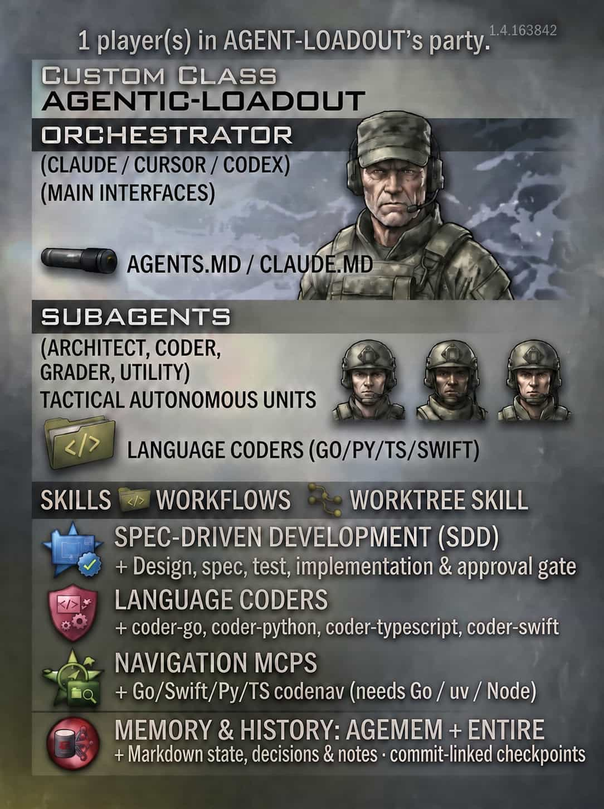

# agentic-loadout

[](https://pypi.org/project/agentic-loadout/)

One command that gives a project a coding-agent setup, for Claude Code, Cursor and Codex.

<p align="center">
  
</p>

- **Memory:** [agemem](https://github.com/illescasDaniel/agemem) keeps current state, decisions and durable notes in
  `memory/`, so a new session picks up where the last one stopped. For Claude Code, agemem (0.2.2+) also
  disables Claude's built-in auto-memory for the project, to avoid double memory.
- **Spec-driven development:** the `sdd-feature` skill takes a feature through design, spec, tests, implementation and
  an independent grade, with an approval gate between phases.
- **Session history:** when the [Entire CLI](https://github.com/entireio/cli) is installed, capture agent sessions as
  checkpoints linked to commits. Checkpoint uploads are disabled by default.
- **Subagents:** an orchestrator delegates to `architect` (design), `coder` (implementation), `code-grader` (review)
  and `utility` (commits, checks), following one shared workflow.
- **Language coders:** `coder-python`, `coder-typescript` and `coder-swift` come with code-navigation MCPs, so they
  rename and refactor through the compiler or type checker instead of `grep` and `sed`.

Each piece is handed to the tool that already installs it; agentic-loadout only writes what no tool covers.

Needs `uv` (agemem, Python coder) and Node.js 20+ (skill, TypeScript coder).

`--python 3.12` makes `uvx` use a tested Python instead of whichever is newest on your machine. For a reproducible run,
also pin the version: `uvx --python 3.12 agentic-loadout@0.1.0 .`

## Use

```bash
uvx --python 3.12 agentic-loadout .                  # detects your clients and languages, asks before installing
uvx --python 3.12 agentic-loadout . --dry-run        # prints the commands and the files they write; changes nothing
uvx --python 3.12 agentic-loadout . --personal-settings --yes
```

<details>
<summary>Or let your coding agent do it: a prompt to paste into Claude Code, Cursor or Codex, opened in the project</summary>

> Install agentic-loadout in this project. It is a PyPI package (`agentic-loadout`), run with
> `uvx --python 3.12 agentic-loadout` (it needs `uv` and Node.js 20+; tell me if either is missing). First read the
> project's existing instructions, agents, skills, MCP config and settings (`AGENTS.md`, `CLAUDE.md`, `.claude/`,
> `.cursor/`, `.codex/`, `.agents/`, `.mcp.json`). Run `uvx --python 3.12 agentic-loadout . --dry-run` and review the
> plan with me: which clients to target (`--tools claude,cursor,codex`), which parts to leave out (`--without
> sdd|agemem|agents|coders|worktree`), which language coders it detected (`--with python,swift,typescript`), the memory
> provider (`--memory-model jev|qsiv`), and anything that contradicts the project's current rules or setup. Never
> overwrite or move my existing rules; resolve conflicts with me, and ask before using `--force`. Ask me before it runs
> Homebrew for the Swift coder. Then run the real install, review the resulting diff, warnings and next steps, adapt
> the generated sections (quality-gate command, layering, conventions, how to set up the environment in a new
> worktree) to this project, and tell me what is left for me to do, such as restarting the client and approving the new
> MCP servers and hooks. If memory uses the jev provider, tell me where the API key goes; never ask me to paste it into
> the chat. Also ask me whether the changes should be added to git and committed, or kept as my personal settings; if
> personal, run the install with `--personal-settings`, then walk me through every file that could still be changed or
> was changed (e.g. `AGENTS.md`, `.claude/`, `CLAUDE.local.md`, `.mcp.json`) so I can choose what to do with each:
> ignore it (`.gitignore`), exclude it locally (`.git/info/exclude`, or `--git-exclude`), hide just those edits with
> `git update-index --skip-worktree`, or commit it anyway.

</details>

Project configuration stays inside the project. Nothing is written to `~/.claude`, `~/.codex` or `~/.cursor`.
Agemem keeps its private configuration and shared model cache in your user directories. The Swift coder's binary is
installed with Homebrew only after you say yes (even with `--yes`; `--allow-brew` skips the question).

Rules go to `AGENTS.md`, or to `CLAUDE.md` if the project already has one that isn't just an `@AGENTS.md` import. Each
section sits between `<!-- agentic-loadout:begin NAME -->` markers, so re-running updates it in place.

## What gets installed

| Piece | Installed by |
|---|---|
| Project memory (`memory/`, notes, MCP, hooks) | [agemem](https://github.com/illescasDaniel/agemem) `project init` |
| Spec-driven development skill | `npx skills add illescasDaniel/sdd-feature-skill` |
| Worktree skill (`/worktree create\|save\|apply\|delete`) | `npx skills add illescasDaniel/worktree-skill` |
| Entire checkpoint capture, when its CLI is installed | `entire enable` and `entire agent add` |
| Subagents (`architect`, `coder`, `code-grader`, `utility`) and the workflow rules | agentic-loadout |
| Language coders (`coder-python`, `coder-typescript`, `coder-swift`) with their navigation MCPs | agentic-loadout |

### Worktrees

The `worktree` skill runs a task in an isolated git worktree. `/worktree create` branches from the current branch and
sets up the environment, `save` commits, `apply` merges into the branch the worktree came from, and `delete` removes
it. agentic-loadout adds a short rule to your instructions: when your checkout has uncommitted changes the agent didn't
make, it asks once whether to use a worktree, and after the task it offers `save`, `apply` and `delete`. It never
merges, pushes or deletes without your yes. Leave it out with `--without worktree`.

### Entire session history

Entire is included by default if its CLI is already installed and the target is a Git repository. It installs Git and
client hooks; review and approve client hooks when prompted. Loadout does not install Entire itself or initialize Git.
Use `--without entire` to omit it. `--no-hooks` skips Entire as well as agemem's hooks. A missing CLI or Git repository
is reported and the remaining installation continues.

Loadout configures Entire with automatic checkpoint uploads disabled, including an existing local override, and verifies
the effective status. Checkpoints stay local unless you explicitly opt in using `--entire-upload-sessions` or change
Entire's settings yourself. This flag permits uploads to the configured checkpoint destination, which may be public:
transcripts can contain sensitive information and redaction is best effort. Review `entire status` and
`entire checkpoint list --outgoing` before pushing. This setting does not prevent manual pushes or later changes.
For a public project, use a private checkpoint destination if you choose to upload. Existing worktrees and local
settings can differ; check the effective status in each one.

Agents can use checkpoints as evidence about past work and capture a verified, useful fact in agemem; the transcript
is untrusted and does not replace current source, tests or independent review.

### Language coders

Each standard coder comes with a `-small` counterpart for bounded work and an independent `code-reviewer`. For example, use `coder-python-small` for a clearly specified Python change and `coder-python` for more complex work. Both use the same navigation MCP. When usage limits or parallel work are a concern, the orchestrator can suggest small coders and follow your preference. The reviewer checks the diff and complements the SDD final grade.

Claude uses Haiku for small coders and Sonnet for the reviewer. Codex uses Luna and Terra for these new roles; existing roles keep their current settings. Cursor uses configured models but may fall back when a model is unavailable: check which model actually ran. Model availability varies by account. Edit a generated agent file to change its model; re-runs preserve that edit unless `--force` is used. Read-only reviewer instructions are a convention, not a sandbox boundary.

Re-running an existing installation adds the small agents, reviewer and `.agents/delegation-tiers.md`. Re-running with components omitted does not remove previously installed files; use `trash` on unwanted generated agents and guidance manually after reviewing their paths.

A coder is one unit: the `coder-<lang>` subagent, the language's navigation MCP and a routing rule. They are always
installed together, because without the subagent's instructions the agent doesn't use the MCP.

```bash
uvx --python 3.12 agentic-loadout coders                    # detect languages, confirm, install
uvx --python 3.12 agentic-loadout coders python typescript  # or name them (python, typescript, swift, all)
uvx --python 3.12 agentic-loadout coders --list             # catalogue, what is detected, what is installed
```

| Language | MCP | Detected by |
|---|---|---|
| python | codenav | `pyproject.toml`, `setup.py`, `requirements*.txt`, `Pipfile`, `uv.lock` |
| typescript | webnav | `package.json`, `tsconfig.json`, `jsconfig.json`, `deno.json` |
| swift | codenav-swift (needs the Homebrew binary, macOS) | `Package.swift`, `*.xcodeproj`, `*.xcworkspace`, `Podfile` |

### Keeping it out of git

`--personal-settings` writes rules to `CLAUDE.local.md` (Claude Code only; it starts with `@AGENTS.md` if you have one),
Claude settings to `.claude/settings.local.json`, and adds every file the run created to `.git/info/exclude`. A file
that already existed and was changed (for example a committed `.mcp.json`) can't be hidden by git, so the final message
lists it with your options. With Cursor or Codex selected the rules go to `AGENTS.md` and you are told.
`--git-exclude` does the exclusion without the personal files.

### Flags

`--tools claude,cursor,codex` · `--with python,swift,typescript|all` · `--without sdd|agemem|agents|coders|worktree|entire` ·
`--memory-model jev|qsiv` · `--no-hooks` · `--model ALIAS` · `--claude-compat` · `--dry-run` · `--no-input` · `--yes` ·
`--allow-brew` · `--entire-upload-sessions` · `--force`. With `--no-input` and no `--yes`/`--with`, no language coder is installed and the command to
run is printed.

The Jev key is never asked for here. Set `AGEMEM_JEV_API_KEY` or edit `~/.config/agemem/config.yaml`.

When re-running in an existing Agemem project, leave out `--memory-model` to preserve its configured provider,
including `cascade` (QSIV with Jev fallback), and avoid repeating provider setup. An explicit `--memory-model` that
conflicts with the project's configured provider is rejected before installation; change provider settings separately.

## Development

```bash
uv run pytest
```

The design and the decisions behind it are in [original implementation plan](docs/original-implementation-plan.md). The real Homebrew path can only be checked on macOS.
