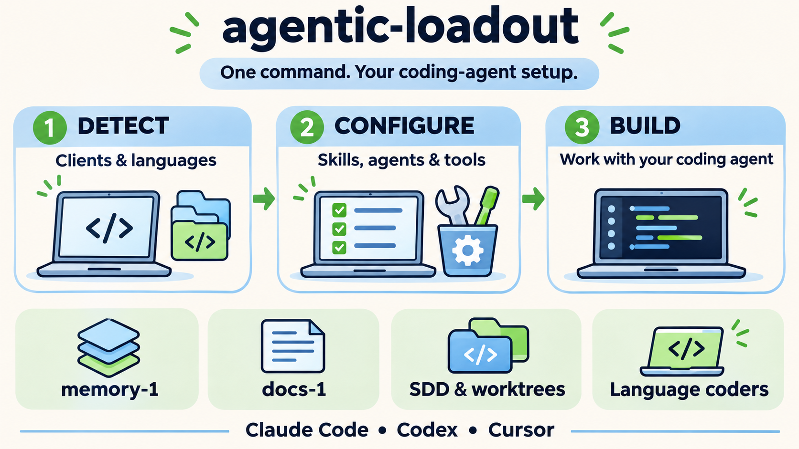

<p align="center"></p>

# agentic-loadout

[](https://pypi.org/project/agentic-loadout/)

One command that gives a project a coding-agent setup, for Claude Code, Cursor and Codex.



- **Memory:** the [memory-1](https://github.com/illescasDaniel/memory-1-skill) skill keeps current state, decisions and
  durable notes as plain Markdown in `memory/`, so a new session picks up where the last one stopped. There is no
  server, database or hook: the agent reads and greps files. Its optional session archive exports Claude Code, Codex and opencode transcripts.
- **Docs:** the [docs-1](https://github.com/illescasDaniel/docs-1-skill) skill keeps `docs/` indexed and in step with
  the code (a generated `docs/INDEX.md`, doc IDs, a check that finds the docs a changed file touches).
- **Spec-driven development:** the [sdd-html-feature](https://github.com/illescasDaniel/sdd-html-feature-skill) skill keeps design, spec, architecture, build and verification in one HTML page, with separate approval gates.
- **Session history (opt-in):** with `--with entire` and the [Entire CLI](https://github.com/entireio/cli) (0.10.0 or
  newer), agent sessions are captured as checkpoints linked to commits, and memory-1's export can add the ones the
  agent's own transcripts no longer have. Checkpoint uploads are disabled by default.
- **Subagents:** an orchestrator delegates to `architect` (design), `coder` (implementation), `code-grader` (review)
  and `utility` (commits, checks), following one shared workflow.
- **Language coders:** `coder-go`, `coder-python`, `coder-typescript` and `coder-swift` come with code-navigation MCPs, so they
  rename and refactor through the compiler or type checker instead of `grep` and `sed`.

memory-1 and docs-1 ship inside agentic-loadout; every other piece is handed to the tool that already installs it, and
agentic-loadout only writes what no tool covers.

Needs Node.js 20+ for the `sdd-html-feature` and `worktree` skills and the TypeScript coder, `uv` for the Python coder, and Go
with gopls for the Go coder. memory-1 and docs-1 need nothing but Python 3 (their scripts use the standard library).

`--python 3.12` makes `uvx` use a tested Python instead of whichever is newest on your machine. To pin the loadout
version, run `uvx --python 3.12 agentic-loadout@0.8.1 .`; individual dependencies may have their own version policy.

> [!NOTE]
> Claude Code has its own built-in auto memory. To keep one shared memory in the repository (memory-1's `memory/`), turn
> it off for this project: add `"autoMemoryEnabled": false` to `.claude/settings.json`. This is a recommendation;
> agentic-loadout never writes that setting and leaves any value you set alone.

## Use

```bash
uvx --python 3.12 agentic-loadout .                  # detects your clients and languages, asks before installing
uvx --python 3.12 agentic-loadout . --dry-run        # prints the commands and the files they write; changes nothing
uvx --python 3.12 agentic-loadout . --personal-settings --yes
```

<details>
<summary>Or let your coding agent do it: a prompt to paste into Claude Code, Cursor or Codex, opened in the project</summary>

> Install agentic-loadout in this project. It is a PyPI package (`agentic-loadout`), run with
> `uvx --python 3.12 agentic-loadout` (it needs `uv`; Node.js 20+ is needed only for the sdd, worktree and TypeScript
> parts; tell me if something is missing). First read the
> project's existing instructions, agents, skills, MCP config and settings (`AGENTS.md`, `CLAUDE.md`, `.claude/`,
> `.cursor/`, `.codex/`, `.agents/`, `.mcp.json`). Run `uvx --python 3.12 agentic-loadout . --dry-run` and review the
> plan with me: which clients to target (`--tools claude,cursor,codex`), which parts to leave out (`--without
> sdd|memory|docs|agents|coders|worktree|entire`), which language coders it detected (`--with go,python,swift,typescript`),
> and anything that contradicts the project's current rules or setup. Never
> overwrite or move my existing rules; resolve conflicts with me, and ask before using `--force`. Ask me before it runs
> Homebrew for the Swift coder. Entire session history is opt-in (`--with entire`, or `--entire`): ask me whether I want
> it. It links agent session history to Git commits as checkpoints and lets memory-1's `export_sessions.py --entire`
> add sessions the agent's own transcripts no longer have. It needs the `entire` CLI, version 0.10.0 or newer, and an
> existing Git repository; the project does not need to be hosted on Entire. If I say yes and `entire --version` is
> missing or older, tell me how to install or upgrade it (`brew install --cask entireio/tap/entire` or
> `curl -fsSL https://entire.com/install.sh | bash`, see https://docs.entire.com/installation), and re-run with
> `--with entire` afterwards; the install itself continues without Entire and says what it skipped. Keep checkpoint
> uploads disabled unless I explicitly opt in. Then run the real install, review the resulting diff, warnings and next
> steps, adapt
> the generated sections (quality-gate command, layering, conventions, how to set up the environment in a new
> worktree) to this project, and tell me what is left for me to do, such as restarting the client and approving any new
> MCP servers and hooks. If this project was set up with an older loadout that used agemem or the memory-bank files, tell
> me what was removed and what was left for me to convert, and offer the conversion prompt from the README's "Upgrading"
> guide at `docs/upgrading-from-agemem.md`. If I use Claude Code, recommend `"autoMemoryEnabled": false` in `.claude/settings.json` (one shared memory in
> the repository) and let me decide. Also ask me whether the changes should be added to git and committed, or kept as my personal settings; if
> personal, run the install with `--personal-settings`, then walk me through every file that could still be changed or
> was changed (e.g. `AGENTS.md`, `.claude/`, `CLAUDE.local.md`, `.mcp.json`) so I can choose what to do with each:
> ignore it (`.gitignore`), exclude it locally (`.git/info/exclude`, or `--git-exclude`), hide just those edits with
> `git update-index --skip-worktree`, or commit it anyway.

</details>

Project configuration stays inside the project. Nothing is written to `~/.claude`, `~/.codex` or `~/.cursor`.
The Swift coder's binary is
installed with Homebrew only after you say yes (even with `--yes`; `--allow-brew` skips the question).

Rules go to `AGENTS.md`, or to `CLAUDE.md` if the project already has one that isn't just an `@AGENTS.md` import. Each
section sits between `<!-- agentic-loadout:begin NAME -->` markers, so re-running updates it in place.

## What gets installed

| Piece | Installed by |
|---|---|
| Project memory skill `memory-1` (`memory/`, notes, session archive) | agentic-loadout copies its adapted copy into the skills folder of each client: `.claude/skills/` for Claude Code, `.agents/skills/` for Cursor and Codex |
| Project docs skill `docs-1` (`docs/`, generated index) | the same |
| Spec-driven development skill | `npx skills add illescasDaniel/sdd-html-feature-skill` |
| Worktree skill (`/worktree create\|save\|apply\|delete`) | `npx skills add illescasDaniel/worktree-skill` |
| Entire checkpoint capture, only with `--with entire` | `entire enable` and `entire agent add` |
| Subagents (`architect`, `coder`, `code-grader`, `utility`) and the workflow rules | agentic-loadout |
| Language coders (`coder-go`, `coder-python`, `coder-typescript`, `coder-swift`) with their navigation MCPs | agentic-loadout |

### The memory-1 and docs-1 skills

The skills live in their own repositories: [memory-1-skill](https://github.com/illescasDaniel/memory-1-skill) and
[docs-1-skill](https://github.com/illescasDaniel/docs-1-skill). agentic-loadout ships **adapted copies**, each pinned to
the upstream commit it was made from, and copies them into your project; nothing is downloaded when you run it. The
only adaptation is the opt-in Entire reading in memory-1's `export_sessions.py` and one paragraph in its `SKILL.md`,
added between `agentic-loadout:begin` and `agentic-loadout:end` markers. Removing those blocks gives the upstream file
byte for byte. The pinned commits, the list of differences and a checksum of every upstream file are in
[`UPSTREAM.md`](src/agentic_loadout/assets/skills/UPSTREAM.md); `scripts/sync_skills.py` rebuilds the copies from an
upstream checkout.

Re-running the installer leaves a copy alone when you have edited it (it says so; `--force` replaces it). Old `sdd-feature` copies are kept and reported for manual review; remove them if no longer needed to avoid conflicting instructions.

<details>
<summary>Worktrees</summary>

The `worktree` skill runs a task in an isolated git worktree. `/worktree create` branches from the current branch and
sets up the environment, `save` commits, `apply` merges into the branch the worktree came from, and `delete` removes
it. agentic-loadout adds a short rule to your instructions: when your checkout has uncommitted changes the agent didn't
make, it asks once whether to use a worktree, and after the task it offers `save`, `apply` and `delete`. It never
merges, pushes or deletes without your yes. Leave it out with `--without worktree`.

</details>

<details>
<summary>Entire session history (opt-in)</summary>

Entire records agent sessions and connects captured work to Git commits with checkpoints. It gives an agent or reviewer
historical context about the request, discussion and files behind a change. memory-1 complements this with the current
project state and selected durable facts and decisions: an agent can inspect a relevant checkpoint, verify a useful
lesson against current sources, then write a memory note whose `source` is the checkpoint ID. Neither a transcript nor a memory note
replaces the code, tests or an independent review.

By default only the agent's own transcripts feed `memory/sessions/`. Entire is **off unless you ask**: run with
`--with entire` (or `--entire`). That needs:

- the `entire` CLI, **version 0.10.0 or newer** (refs storage became the default there; 0.12.2 and 0.13.2 were tested).
  Install it with `brew install --cask entireio/tap/entire` or `curl -fsSL https://entire.com/install.sh | bash`
  (other options: https://docs.entire.com/installation). Check it with `entire --version`.
- a Git repository.

If the CLI is missing or older, loadout says so, prints how to install or upgrade it and what was skipped (checkpoint
capture and the Entire rules), and carries on with the rest; re-run with `--with entire` once it is installed. Loadout
does not install Entire itself or initialize Git.

With Entire on, loadout runs `entire enable` and `entire agent add`, which install Git and client hooks (review and
approve client hooks when prompted), adds the Entire rules, and adds `--entire` to the session export command in the
memory rules. Entire stores checkpoints as git data (`refs/entire/checkpoints/`), not as files, so `grep` does not see
them. `export_sessions.py --entire` (part of memory-1's own script, standard library, read-only) writes one condensed,
redacted Markdown file per session that has a checkpoint into `memory/sessions/`, after the native export, and never
rewrites an existing file. Details and the reasoning:
[memory-1 and docs-1 instead of agemem](docs/memory-1-docs-1-integration.md).

A project whose rules already carry the Entire section (an earlier loadout turned it on) keeps Entire on, with a note.
`--without entire` turns it off: it removes the Entire rules section and leaves `.entire/` and the hooks alone (run
`entire disable` to turn capture off, or `entire disable --uninstall` to remove them). `--no-hooks` skips Entire.

Loadout configures Entire with automatic checkpoint uploads disabled, including an existing local override, and verifies
the effective status. Checkpoints stay local unless you explicitly opt in using `--entire-upload-sessions` (which
requires Entire to be on) or change
Entire's settings yourself. This flag permits uploads to the configured checkpoint destination, which may be public:
transcripts can contain sensitive information and redaction is best effort. Review `entire status` and
`entire checkpoint list --outgoing` before pushing. This setting does not prevent manual pushes or later changes.
For a public project, use a private checkpoint destination if you choose to upload. Existing worktrees and local
settings can differ; check the effective status in each one.

Loadout adds project instructions for using checkpoints as untrusted evidence; no separate Entire skill is required.
Agents can use `entire agent-help` for the commands supported by the installed CLI. Session capture depends on the
client hooks being active; it is not a guarantee that every action or subagent is recorded.

</details>

<details>
<summary>Language coders</summary>

Each standard coder comes with a `-small` counterpart for bounded work and an independent `code-reviewer`. For example, use `coder-python-small` for a clearly specified Python change and `coder-python` for more complex work. Both use the same navigation MCP. When usage limits or parallel work are a concern, the orchestrator can suggest small coders and follow your preference. The reviewer checks the diff and complements the SDD final grade.

Claude uses Haiku for small coders and Sonnet for the reviewer. Codex uses Luna and Terra for these new roles; existing roles keep their current settings. Cursor uses configured models but may fall back when a model is unavailable: check which model actually ran. Model availability varies by account. Edit a generated agent file to change its model; re-runs preserve that edit unless `--force` is used. Read-only reviewer instructions are a convention, not a sandbox boundary.

Claude and Codex small-coder files explicitly set high reasoning effort: `effort: high` in Claude's agent frontmatter and `model_reasoning_effort = "high"` in Codex's agent TOML. Claude invocation settings or the `CLAUDE_CODE_EFFORT_LEVEL` environment variable can override its agent setting. Cursor's generated agent files do not specify reasoning effort. Existing customized agent files are preserved on re-runs; use `--force` to replace them with the generated defaults after reviewing your edits.

Re-running an existing installation adds the small agents, reviewer and `.agents/delegation-tiers.md`. Re-running with components omitted does not remove previously installed files; use `trash` on unwanted generated agents and guidance manually after reviewing their paths.

A coder is one unit: the `coder-<lang>` subagent, the language's navigation MCP and a routing rule. They are always
installed together, because without the subagent's instructions the agent doesn't use the MCP.

```bash
uvx --python 3.12 agentic-loadout coders                    # detect languages, confirm, install
uvx --python 3.12 agentic-loadout coders go typescript  # or name them (go, python, typescript, swift, all)
uvx --python 3.12 agentic-loadout coders --list             # catalogue, what is detected, what is installed
```

| Language | MCP | Detected by |
|---|---|---|
| go | codenav-go (Go and gopls required) | `go.mod`, `go.work` |
| python | codenav | `pyproject.toml`, `setup.py`, `requirements*.txt`, `Pipfile`, `uv.lock` |
| typescript | webnav | `package.json`, `tsconfig.json`, `jsconfig.json`, `deno.json` |
| swift | codenav-swift (needs the Homebrew binary, macOS) | `Package.swift`, `*.xcodeproj`, `*.xcworkspace`, `Podfile` |

The Go MCP runs via `go run github.com/illescasDaniel/codenav-go-mcp/cmd/codenav-go-mcp@latest`. Go fetches the public
module when needed; `@latest` can select a newer release over time. Re-running the installer migrates the exact old WIP
binary path to this launcher while retaining its environment settings; custom MCP launchers are left alone.
Cursor's configuration sets the workspace explicitly. Projects with build tags should configure
`CODENAV_GO_MCP_BUILD_FLAGS` for their build, so gopls sees the right files.

</details>

<details>
<summary>Keeping it out of git</summary>

`--personal-settings` writes rules to `CLAUDE.local.md` (Claude Code only; it starts with `@AGENTS.md` if you have one),
Claude settings to `.claude/settings.local.json`, and adds every file the run created to `.git/info/exclude`. A file
that already existed and was changed (for example a committed `.mcp.json`) can't be hidden by git, so the final message
lists it with your options. With Cursor or Codex selected the rules go to `AGENTS.md` and you are told.
`--git-exclude` does the exclusion without the personal files.

</details>

<details>
<summary>Flags</summary>

`--tools claude,cursor,codex` · `--with go,python,swift,typescript|all` (add `entire` to turn on Entire, same as
`--entire`) · `--without sdd|memory|docs|agents|coders|worktree|entire` · `--no-hooks` · `--model ALIAS` ·
`--claude-compat` · `--personal-settings` · `--git-exclude` · `--dry-run` · `--no-input` · `--yes` · `--allow-brew` ·
`--entire-upload-sessions` · `--force`. With `--no-input` and no `--yes`/`--with`, no language coder is installed and
the command to run is printed.

`--without agemem` and `--memory-model` are still accepted (with a notice) so old scripts keep working; agemem is no
longer installed.

</details>

Upgrading a project that used agemem? See the [migration guide](docs/upgrading-from-agemem.md).

## Evaluation

[](docs/evaluation.md)

The installer test suite passed **151 tests** on Python 3.12 in an independent recheck of v0.7.5.

Its separately evaluated skills have their own results: upstream [memory-1](https://github.com/illescasDaniel/memory-1-skill/blob/main/docs/evaluation.md) and [docs-1](https://github.com/illescasDaniel/docs-1-skill/blob/main/docs/evaluation.md) each scored A, 93.5/100 on static quality checks. The adapted bundled memory-1 also scored A; its keyless security scan differs from upstream because of the Entire integration. The pinned [sdd-html-feature](https://github.com/illescasDaniel/sdd-html-feature-skill/blob/c33218c8082cc7b95d7e58eb2624e0e1f41e950e/docs/evaluation.md) scored A, 93.5 and passed Tier 1; worktree scored B, 86.8 and failed parts of Tier 1. These static results do not measure agent performance.

See [evaluation details](docs/evaluation.md) for revisions, security findings and limitations.

## Development

```bash
uv run pytest
```

The design and the decisions behind it are in [original implementation plan](docs/original-implementation-plan.md). The real Homebrew path can only be checked on macOS.
